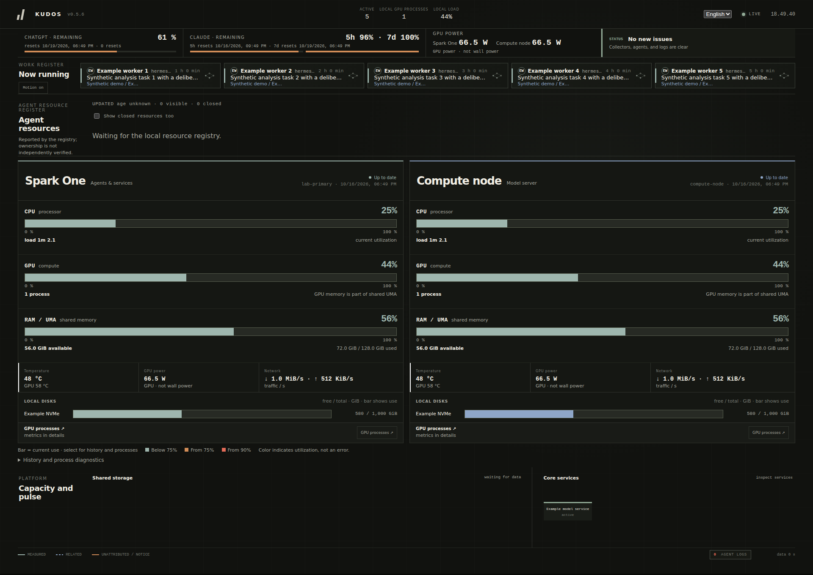

# KUDOS

[](https://github.com/Resnais-Beefhair/spark-kudos/actions/workflows/ci.yml)
[](LICENSE)


**A quiet, live operations dashboard for one or two NVIDIA DGX Spark systems.**

CPU, unified memory, GPU telemetry, network, storage and optional services in one
read-only browser view. English by default, Finnish when you want it. No JavaScript
framework, external CDN, cloud account or private source repository is required.

> **Security:** KUDOS has no authentication. It binds to `127.0.0.1` by default.
> Do not expose it to the internet. Use an authenticated HTTPS reverse proxy or an
> SSH tunnel for remote access. [Read the security model](SECURITY.md).



*Illustrative synthetic telemetry, not a production capture.*

## What it does

- One local machine; optionally a second Spark through existing read-only SSH access.
- Independently fresh host panels, 15-minute in-memory histories and resource drilldowns.
- Configurable host labels, network interfaces, mounted volumes and systemd/HTTP services.
- [Volume-space details](docs/STORAGE.md): largest directories/files, allocated sizes,
  bounded on-demand scans and explicit partial results, not host-wide process I/O.
- Optional model-server metrics and opt-in agent, cron, quota and privacy-filtered log adapters.
- Independent [Claude subscription limits](docs/CLAUDE-QUOTA.md), using an existing local Claude Code login without changing it.
- A real English/Finnish language switch, including dynamic dialogs and accessible labels.
  Your explicit choice stays in your browser; the site default is configurable.
- Unknown or stale values stay unknown. Device power is not wall power. Spark GPU
  memory is unified memory, not a separate pool to add to system RAM.

The base installation does **not** discover your agents, read their logs, assume a
second host or require any particular application. Every such integration is opt-in.

## Requirements

- Linux and Python 3.12 or later. Primary target: NVIDIA DGX Spark / GB10, ARM64.
  Ordinary Linux machines can run the base view, but are not the primary support target.
- For a second host: `ssh`, an existing verified SSH route, and remote Python 3 + `psutil`.
- For directory/file size details: GNU `du` (coreutils), locally and on a queried remote host.
- For GPU readings: a configured, existing shared JSON telemetry producer. KUDOS reads
  its state; it does **not** poll NVML/`nvidia-smi`, install a GPU daemon, manage GPU clocks
  or take over a thermal guard. [GPU source contract](docs/GPU-TELEMETRY.md).
- For systemd service cards: `systemctl` and access to the declared units. Neither
  systemd nor agent software is required for the base CPU/memory/network view.

## Run from source

Clone or download [Resnais-Beefhair/spark-kudos](https://github.com/Resnais-Beefhair/spark-kudos), then from its root:

```bash
git clone https://github.com/Resnais-Beefhair/spark-kudos.git
cd spark-kudos
uv sync --extra dev
uv run sisu-kudos
```

Open <http://127.0.0.1:8787>. The technical package and command retain their original
name, `sisu-kudos`; the product is called **KUDOS**. No PyPI publication is assumed.

Without uv:

```bash
python3 -m venv .venv
. .venv/bin/activate
python -m pip install .
sisu-kudos
```

## Install a release package

Download the wheel from [GitHub Releases](https://github.com/Resnais-Beefhair/spark-kudos/releases).
The current public release is 0.5.18. No PyPI package is published. From the download directory:

```bash
uv tool install ./sisu_kudos-0.5.18-py3-none-any.whl
sisu-kudos --version
sisu-kudos
```

The source archive includes example configs and documentation. Configure GPU telemetry
separately; installing the wheel does not install a GPU producer or expose a network port
beyond the default loopback listener.

## Make it yours

Start with [one Spark](examples/single-spark.toml) or
[two Sparks](examples/two-sparks.toml). Validate before starting:

```bash
uv run sisu-kudos --config examples/single-spark.toml --check-config
uv run sisu-kudos --config examples/single-spark.toml
```

Choose **Suomi** in the header to use Finnish. Set `language = "fi"` in the
application config for Finnish as the site default. An explicit browser selection
wins over the site default. Configuring KUDOS does not change an agent's language.

Keep your actual configuration outside the checkout. Never commit credentials,
host addresses, production screenshots, agent payloads or local configuration files.
The [configuration reference](docs/CONFIGURATION.md) covers precedence and every
supported field. [Deployment](docs/DEPLOYMENT.md) includes a user-service example.

## Project guide

- [Documentation index](docs/INDEX.md)
- [Architecture and data boundaries](ARCHITECTURE.md)
- [Contributing and verification](CONTRIBUTING.md)
- [Security and disclosure](SECURITY.md)
- [Changes](CHANGELOG.md)
- [MIT license](LICENSE)

## Support and contributions

Maintained at [Resnais-Beefhair/spark-kudos](https://github.com/Resnais-Beefhair/spark-kudos).
For reproducible bugs, use [GitHub Issues](https://github.com/Resnais-Beefhair/spark-kudos/issues)
with generic labels and synthetic data. For proposed integrations, open an issue before
adding a dependency. Read [CONTRIBUTING.md](CONTRIBUTING.md) for local checks and
[SECURITY.md](SECURITY.md) before reporting a vulnerability. Do not post real logs or
operational screenshots. The 0.5.x series is beta software; interfaces may evolve.

## Boundaries

KUDOS is an observability tool, not a process manager. It does not restart services,
run trades, send messages, modify agent databases or control GPU power. Sessions and
logs stay behind explicit read-only adapters and browser payload allowlists. There
is no persistent metrics database; history starts again after a restart.

Configuration enables only supported adapters, not arbitrary shell commands or
plugins loaded from untrusted input. Enabling a local source allows the dashboard
process to read it; apply normal OS permissions and review what the browser may see.
